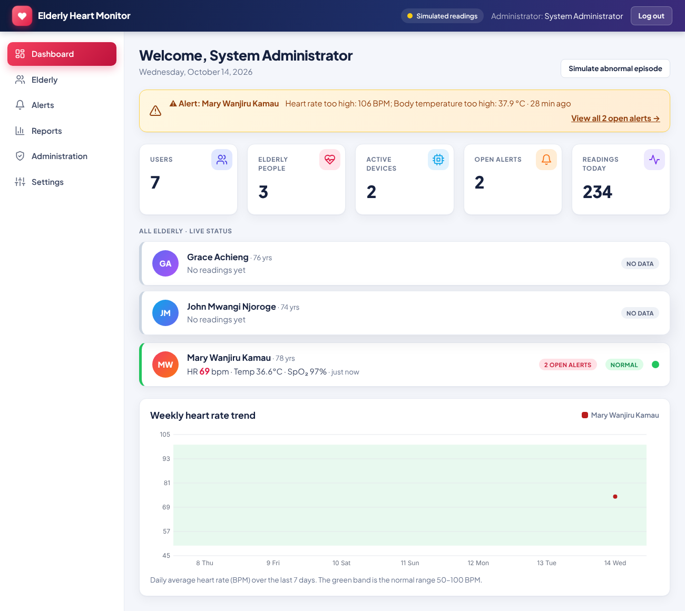

# Elderly Cardiovascular Health Monitoring System (IS Project II)

*A Web-Based IoT-Enabled Heart Rate Monitoring and Emergency Alert System for Elderly Patients*
Final Year IS Project. Gitonga Cyrus Collins (167071), Strathmore University.

A simulated ESP32 (Wokwi) sends heart rate, body temperature and SpO₂ readings every 3 seconds. The web app saves them in MySQL, checks them against each person's thresholds, and alerts caregivers and healthcare providers on their dashboards and by SMS. Elderly users have a panic button.



## What's in this repository

| Folder | What it is |
|---|---|
| `webapp/` | The full system: Node.js + Express, linked to MySQL. Login for all four roles, dashboards, patient pages, alerts, reports, administration and the panic button. Start here: [webapp/README.md](webapp/README.md) |
| `database/` | MySQL schema (13 tables, matching the ERD), sample data and demo queries. See [database/DATABASE-SETUP.md](database/DATABASE-SETUP.md) |
| `wokwi/` | ESP32 sketch for the Wokwi online emulator |
| `server/` | The 30% milestone demo (live dashboard, no database). See [docs/30-PERCENT-DEMO.md](docs/30-PERCENT-DEMO.md) and [SETUP-GUIDE.md](SETUP-GUIDE.md) |
| `diagrams/` | ERD, database schema, class, use case and sequence diagrams (PNG + editable draw.io), with the scripts that drew them in `diagrams/src/` |

## Quick start (Windows)

1. Start **MySQL** in XAMPP and import `database/schema.sql`, then `database/seed.sql`, into your database.
2. In VS Code, open the `webapp` folder and run:
   ```
   npm install
   npm start
   ```
3. Open http://localhost:3000 and log in as `peter.kamau@heartmonitor.test` with password `Password123`.

## Stack

HTML, CSS and JavaScript · Node.js + Express · MySQL · MQTT (HiveMQ public broker) · Wokwi ESP32 emulator · SMS gateway (simulated for now)

## Status

- Done: IoT emulator, live readings, threshold alerts, database, all pages and forms, panic button.
- Next: connect a real SMS gateway API.
